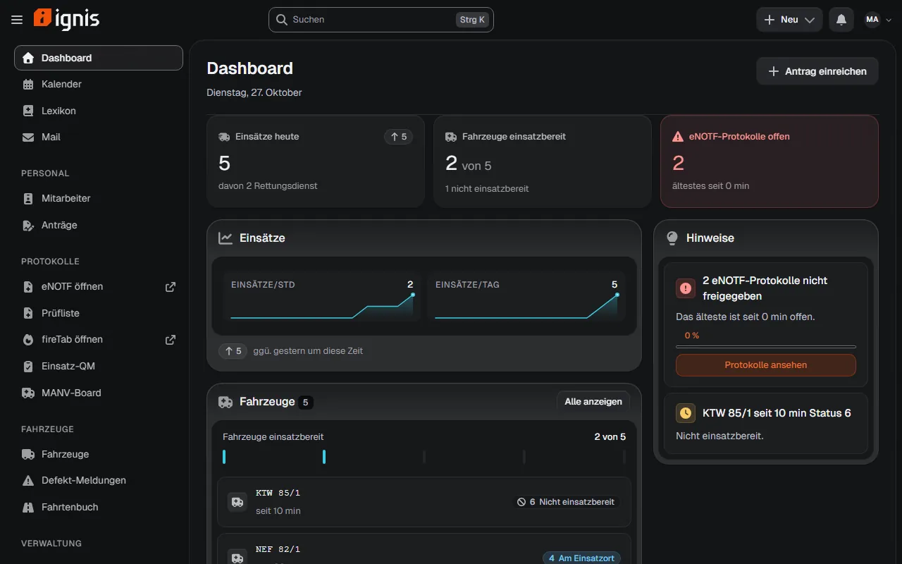
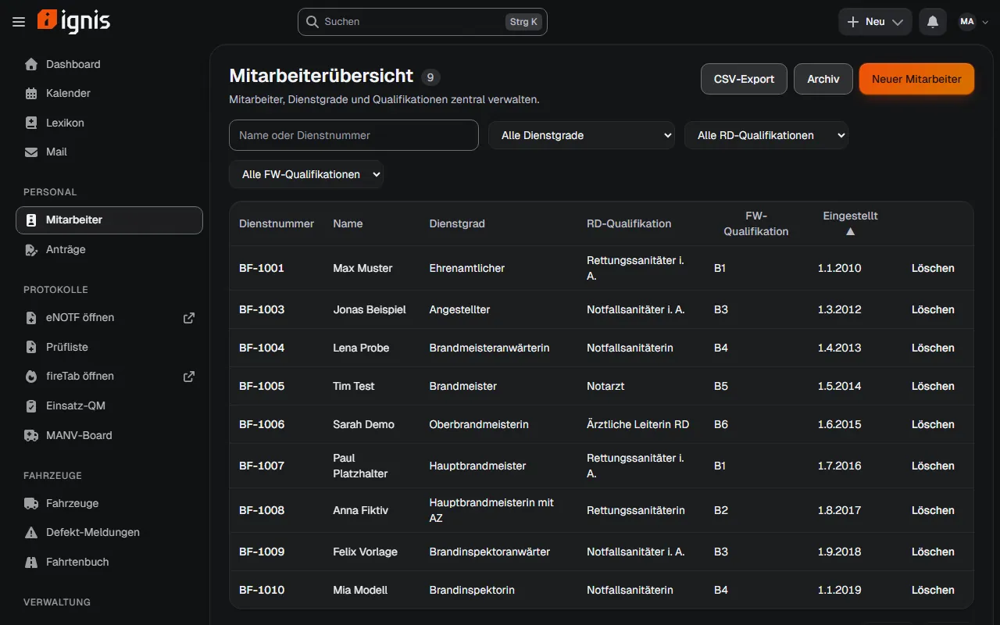
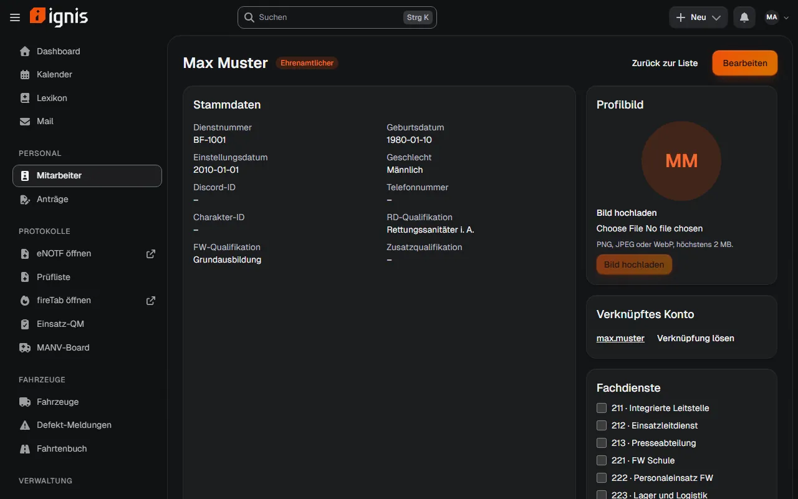
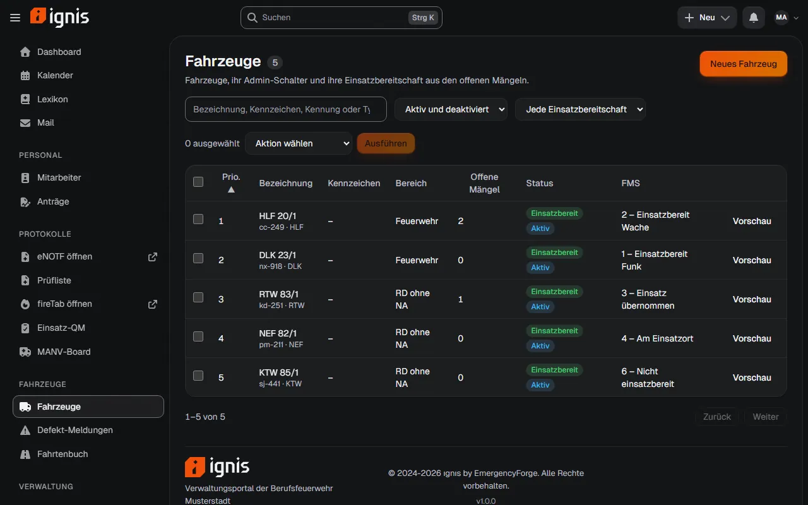
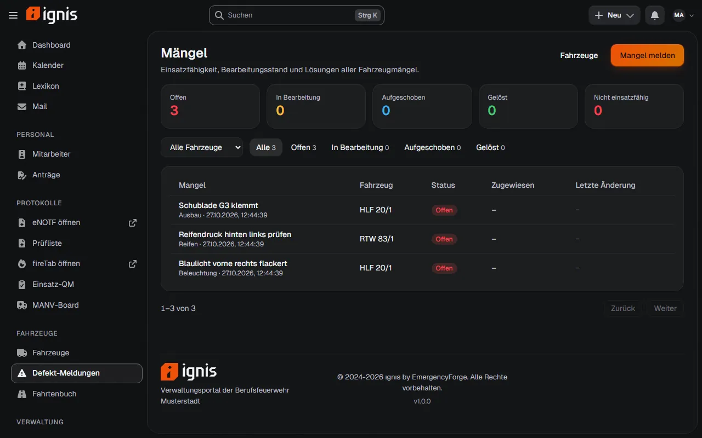
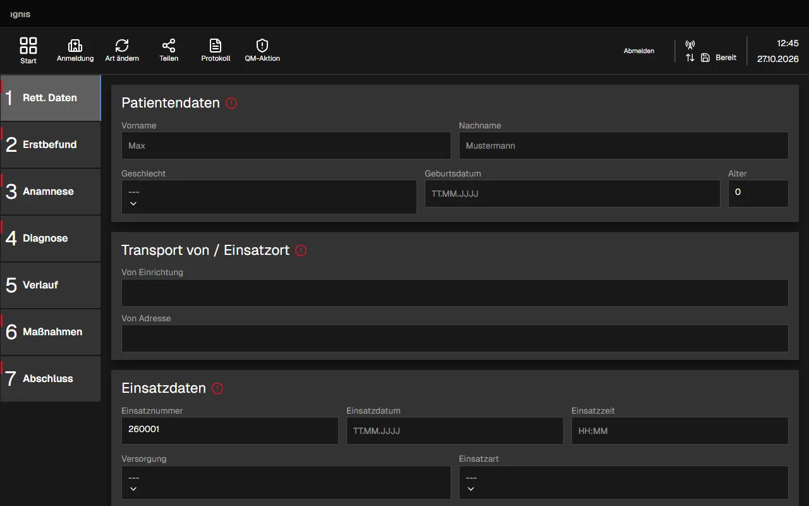
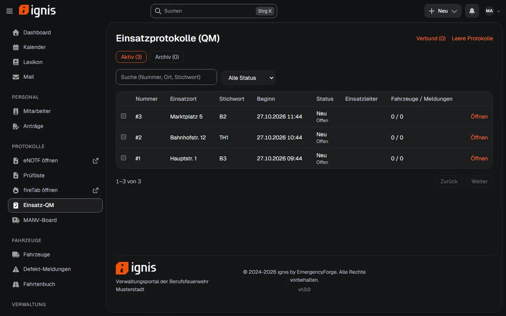
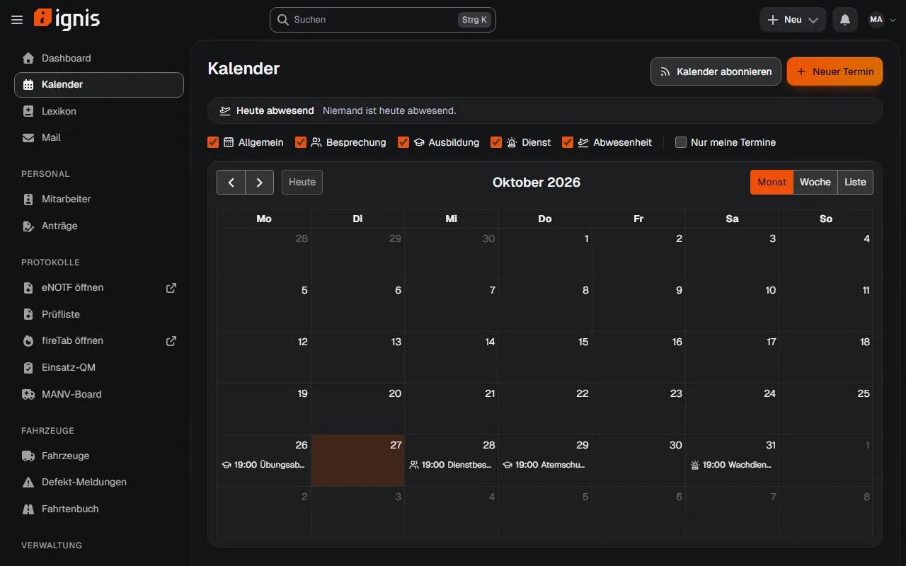
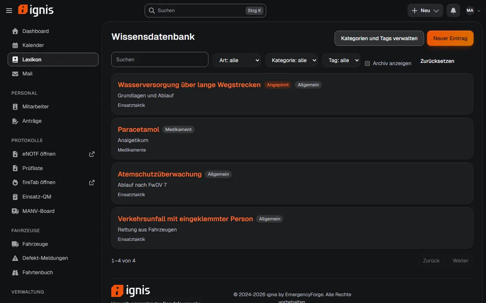
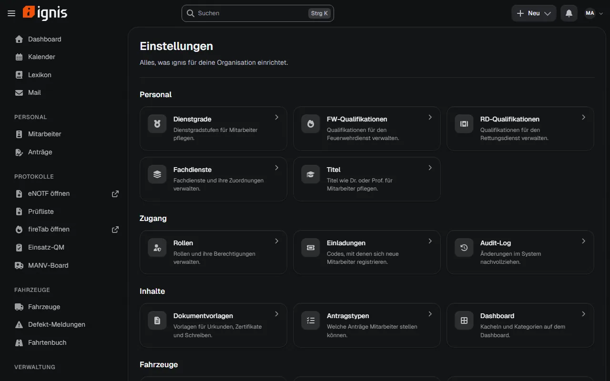

# ignis

ignis ist ein Verwaltungspanel für Feuerwehr und Rettungsdienst auf FiveM-Roleplay-Servern. Es verwaltet Personal,
Dokumente und Fahrzeuge, hat Tablets für Einsatz- und Notfallprotokolle, ein internes Postfach, einen Kalender und eine
Wissensdatenbank. Mit dem FiveM-Server redet es über `ef_bridge`.

## Wie das Projekt entstanden ist

Das hier ist ein Neubau von [ignis](https://github.com/EmergencyForge/ignis) (früher intraRP). Das Original ist in
reinem PHP ohne Framework geschrieben. Ich habe es in Laravel nachgebaut, weil es dadurch einfacher zu pflegen und zu
erweitern ist: ein Framework, das viele kennen, Tests, Datenbank-Migrationen, Warteschlange und Module mit klarer
Struktur.

Deine alten Daten gehen nicht verloren. Ein Befehl übernimmt sie aus dem Altsystem, alte Adressen werden auf die neuen
umgeleitet, und `ef_bridge` spricht weiter mit denselben Schnittstellen wie vorher. Was bewusst anders ist oder wegfällt, steht in [docs/dev/import.md](docs/dev/import.md).

## Wichtig vorab

Die Software kann Fehler haben, und das wird auch so bleiben. Vieles ist mit Tests abgesichert, aber nicht alles wurde in
einer echten Umgebung ausprobiert. Noch nicht getestet sind zum Beispiel:

- der Betrieb in echtem FiveM (Tablet, Tastatur, Zusammenspiel mit `ef_bridge`)
- Discord mit echtem Bot und echten Webhooks
- Echtzeit hinter einem TLS-Proxy und die Kopplung von zwei Instanzen
- ein Import mit einer echten Datenbank aus dem Altsystem
- das Update per Klick gegen ein echtes Release
- viele Spieler gleichzeitig

Mach vor jedem Import und jedem Update eine Sicherung. Wenn dir ein Fehler auffällt, schreib ein Issue mit Version,
den Schritten zum Nachstellen und dem passenden Log-Auszug. Bitte ohne Passwörter, Tokens oder Patientendaten.

Die Version 1.0.0 ist vorbereitet, aber noch nicht veröffentlicht.

## So sieht es aus

Alle Bilder zeigen erfundene Demodaten.

| | |
|---|---|
| <br>Startseite | <br>Mitarbeiter |
| <br>Personalakte | <br>Fahrzeuge |
| <br>Fahrzeugmängel | <br>eNOTF-Protokoll |
| <br>FireTab: Einsatz-QM | <br>Kalender |
| <br>Wissensdatenbank | <br>Einstellungen |

## Installation

Du brauchst Docker (mit Compose v2) und eine Discord-Anwendung für die Anmeldung. Wie du die anlegst, steht in
[INSTALL.md](INSTALL.md).

```
git clone <Repository-URL> ignis
cd ignis
cp docker/.env.example .env
```

Öffne die Datei `.env` und trag vier Werte ein:

- `DB_PASSWORD`: ein langes Zufallspasswort
- `APP_URL`: die Adresse, unter der ignis später läuft, zum Beispiel `https://ignis.example.org`
- `IGNIS_INSTALL_TOKEN`: ein Zufallswert, zum Beispiel aus `openssl rand -hex 24`
- `UPDATER_SECRET`: noch ein Zufallswert, zum Beispiel aus `openssl rand -hex 32`

Dann starten:

```
docker compose up -d --build
```

Nach ein bis zwei Minuten läuft alles. Öffne `/install` im Browser, gib den Install-Token ein und folge dem Assistenten.
Der fragt nach dem Namen deiner Organisation, den Discord-Daten und dem ersten Administrator.

Zum Schluss leerst du `IGNIS_INSTALL_TOKEN` in der `.env`, startest mit `docker compose up -d` neu und prüfst mit
`docker compose exec app php artisan ignis:preflight`, ob alles passt.

Für den echten Betrieb gehört ein Reverse-Proxy mit HTTPS davor. Das und alles andere (Echtzeit, Sicherung, Betrieb
ohne Docker) steht in [INSTALL.md](INSTALL.md).

## Updates

ignis kann sich selbst aktualisieren: unter *Einstellungen > System* auf "Jetzt prüfen" klicken. Neue Versionen kommen
von den GitHub-Releases. Installiert wird nur, was eine gültige Signatur hat. Vorher legt ignis eine Sicherung an und
probiert die Datenbank-Änderungen an einer Kopie aus. Geht beim Update etwas schief, rollt es auf den alten Stand zurück.

## Vom Altsystem umziehen

```
php artisan ignis:import-legacy
```

liest die alte Datenbank (nur lesend) und übernimmt Rollen, Konten, Personal, Dokumente, Fahrzeuge und die Daten der
Fachmodule. Mit `--uploads` kommen auch Profilbilder, Logo und Anhänge mit. Den Import kannst du bis zur Umstellung
beliebig oft wiederholen, nichts wird doppelt angelegt. Nicht übernommen werden Discord-Bot-Token und Webhooks, die trägst
du neu ein. Die Details stehen in [docs/dev/import.md](docs/dev/import.md).

## Was drinsteckt

Der Kern kümmert sich um Konten und Rechte (Anmeldung über Discord), Personal, Dokumente, Fahrzeuge, Startseite mit
Suche und Benachrichtigungen, Einstellungen und den Datenaustausch mit `ef_bridge`. Alles Weitere sind Module, die du
einzeln ein- und ausschalten kannst:

| Modul | Was es kann |
|---|---|
| `Logbook` | Fahrtenbuch |
| `KnowledgeBase` | Wissensdatenbank, auf Wunsch öffentlich lesbar |
| `Forms` | Anträge mit Antragstypen und Entscheidung |
| `Calendar` | Termine, Serien, iCal-Abo, Abwesenheiten |
| `ManvBoard` | MANV-Board mit Lagen, Patienten und Sichtung |
| `Mail` | internes Postfach mit Gruppen, Verteilern und Anhängen |
| `FireTab` | Feuerwehr-Tablet mit Einsatzprotokoll, Atemschutz und Lagekarte |
| `Enotf` | Notfallprotokoll auf dem Tablet, mit Klinikportal und Abrechnung |
| `Federation` | mehrere Instanzen koppeln (standardmäßig aus) |

## Für Entwickler

Technik: PHP 8.3 oder neuer (Docker nutzt 8.4), Laravel 13, Inertia, Vue 3, TypeScript, Tailwind 4, MariaDB 11 im Betrieb
und SQLite für Tests.

```
composer setup     # Abhängigkeiten, .env, Schlüssel, Migrationen, Frontend
composer dev       # Entwicklungsumgebung
composer test      # Tests (Pest)
composer analyse   # PHPStan
composer lint -- --test
npm run build      # Typprüfung und Frontend-Build
```

Die Ordner: `app/` ist der Kern, `modules/` enthalten die Module, `resources/js/` die Oberfläche, `docs/dev/` die
Entwicklerdoku ([Übersicht](docs/dev/README.md)). Welche Tests es gibt und wie du sie einzeln startest, steht in
[docs/dev/tests.md](docs/dev/tests.md#testgruppen). Die CI läuft nur mit Lint, PHPStan und Build,
die Tests laufen lokal.

## Lizenz

GPL-3.0-or-later, siehe [LICENSE](LICENSE). Das Projekt baut auf intraRP, intra.stettbeck.de (itshypax) und ignis
(EmergencyForge) auf. Die Einzelheiten stehen in [NOTICE](NOTICE) und [THIRD_PARTY_NOTICES.md](THIRD_PARTY_NOTICES.md).
